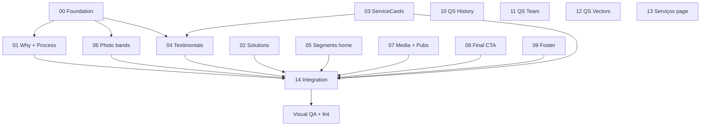

# Plano multiagente — Site Vozes (prototipo)

Repositório: `/Users/anaterra/Documents/GitHub/site-vozes-prototipo`  
Stack: React + Vite + Tailwind + Motion (`motion/react`) + Lucide (onde aplicável)

## Objetivo

Implementar o pacote de mudanças de **Home**, **Quem somos** e **O que fazemos / Nossos serviços**, com **um agente por área de arquivos**, sem editar os mesmos arquivos em paralelo.

## Regras globais

1. **Ownership**: só o agente dono edita os arquivos listados em sua ficha. Outros agentes abrem issue no log do integrador se precisarem de mudança cruzada.
2. **Branch**: `feat/vozes-ui-refresh` a partir de `main`. Cada agente trabalha na mesma branch; commits pequenos com prefixo `[Axx]`.
3. **Integração**: o **Agente 14** é o único que pode editar `src/pages/HomePage.tsx` após a fase paralela (exceto Agentes 04 e 05 que entregam componentes importáveis sem tocar no restante da page).
4. **Motion**: respeitar `useReducedMotion()` como em `WhyWeExist.tsx` e `ProcessScroll.tsx`.
5. **Figma (Publicações)**: node [7492-445](https://www.figma.com/design/WFci48N6CPTd2UVMnhFiyh/sitefigma?node-id=7492-445&m=dev) — responsabilidade exclusiva do Agente 07.
6. **Assets pendentes**: fotos de infância da equipe e imagens de referência do CTA — usar placeholders nomeados `team-{slug}-childhood.png` até o cliente enviar; registrar no execution log.
7. **Ao concluir**: preencher o execution log do agente e marcar status no quadro abaixo.

## Mapa de dependências

## Quadro de status

| Agente | Escopo | Status |
|--------|--------|--------|
| 00 | Foundation + contratos | ✅ |
| 01 | Home — Por que existimos + linha ProcessScroll | ✅ |
| 02 | Home — Soluções + parceiros (bloco paper) | ✅ |
| 03 | Home — ServiceCards | ✅ |
| 04 | Home — Depoimentos (camada parallax) | ✅ |
| 05 | Home — Com quem trabalhamos | ✅ |
| 06 | Home — Faixas foto + copy “ecoamos” | ✅ |
| 07 | Home — Mídia + Publicações (Figma) | ✅ |
| 08 | Home — CTA final (antes do footer) | ✅ |
| 09 | Footer global | ✅ |
| 10 | Quem somos — Nossa história (carrossel Libra) | ✅ |
| 11 | Quem somos — Equipe (flip + layout) | ✅ |
| 12 | Quem somos — Como trabalhamos (SVG) | ✅ |
| 13 | O que fazemos — seção serviços (redesign) | ✅ |
| 14 | Integração HomePage + QA | ✅ |

---

## Agente 00 — Foundation

**Log:** [logs/AGENT-00-foundation.md](./logs/AGENT-00-foundation.md)

**Pode editar**

- `src/components/motion/ParallaxPhotoSection.tsx` (criar)
- `src/components/motion/index.ts` (criar, se necessário)
- `docs/multiagent/CONTRATOS.md` (criar — props dos novos componentes)
- Este `PLANO.md` (apenas coluna Status, se coordenador)

**Não tocar**

- Páginas e seções visuais (só contratos).

**Entregas**

1. Componente reutilizável `ParallaxPhotoSection`: foto move suavemente (Y), texto fixo no centro, overlay configurável — padrão já usado em `WhyWeExist.tsx`.
2. Documentar API em `CONTRATOS.md` para Agentes 01, 06.
3. Lista de imports que o Agente 14 usará na integração.

**Critérios de aceite**

- Parallax desliga com `prefers-reduced-motion`.
- Sem dependência de `HomePage.tsx`.

---

## Agente 01 — Home: Por que existimos + ProcessScroll

**Log:** [logs/AGENT-01-home-why-process.md](./logs/AGENT-01-home-why-process.md)

**Pode editar**

- `src/components/home/WhyWeExist.tsx`
- `src/components/home/ProcessScroll.tsx`

**Não tocar**

- `HomePage.tsx`, `WordBalloon.tsx` (só consumir), `ServiceCards`, `SolutionsIntro`.

**Tarefas**

1. **Por que existimos**: confirmar parallax (texto parado, foto sobe suavemente). Ajustar range/velocidade se necessário.
2. Remover **pilula escura** atrás de “É aí que o Vozes entra”; remover balão; texto **branco** simples (sem pill `bg-[#1a122e]`).
3. **ProcessScroll — linha parallax**: dot percorre a linha do início ao fim no scroll; tamanho do círculo e do texto podem variar; texto **centralizado no dot**, 2–3 linhas, caminha com o dot.

**Referência técnica**

- `ProcessScroll.tsx` já usa `useScroll` + linha + dot — refinar comportamento conforme briefing, não reimplementar na HomePage.

**Critérios de aceite**

- Copy intacto salvo onde o briefing manda remover estilo de balão/pill.
- Scroll suave em desktop; fallback estático com reduced motion.

---

## Agente 02 — Home: Soluções + parceiros

**Log:** [logs/AGENT-02-home-solutions.md](./logs/AGENT-02-home-solutions.md)

**Pode editar**

- `src/components/home/SolutionsIntro.tsx`
- `src/components/content/PartnerStrip.tsx` — **apenas** props opcionais (`heading`, `showTitle`) e estilos do título; não alterar lógica do belt.

**Não tocar**

- `ServiceCards.tsx`, `HomePage.tsx` (Agente 14 reposiciona blocos).

**Tarefas**

1. Remover `MorphPillButton` de `SolutionsIntro`; o CTA “Fale conosco” passa a ficar **depois dos serviços** (Agente 14 coloca na Home; Agente 02 exporta slot ou componente `SolutionsBlockFooter` se preferir).
2. Aumentar **respiro** vertical entre: título/intro, faixa de parceiros, área dos serviços (via classes em `SolutionsIntro` + documentar spacing esperado para o integrador).
3. Na faixa de parceiros desta seção: label apenas **“PARCEIROS”** (estilo parágrafo de “clientes e parceiros” — tipografia uppercase tracking existente no site).

**Entrega para integração**

- Nota no log: ordem desejada no `<section className="bg-paper">`: `SolutionsIntro` → `PartnerStrip` → `ServiceCards` → CTA contato.

---

## Agente 03 — Home: ServiceCards

**Log:** [logs/AGENT-03-home-service-cards.md](./logs/AGENT-03-home-service-cards.md)

**Pode editar**

- `src/components/home/ServiceCards.tsx`

**Tarefas**

1. Título do box: **topo, alinhado à esquerda**.
2. Rostinho (SVG): **canto inferior esquerdo**.
3. Descrição no hover: **mais espaço** abaixo do título; fonte **ligeiramente maior**.
4. “Saiba mais”: **canto inferior direito** com **seta** (Lucide `ArrowRight` ou padrão do site).

**Critérios de aceite**

- Hover/focus acessível; animações existentes preservadas ou melhoradas.

---

## Agente 04 — Home: Depoimentos (camada)

**Log:** [logs/AGENT-04-home-testimonials.md](./logs/AGENT-04-home-testimonials.md)

**Pode editar**

- `src/components/home/TestimonialsLayer.tsx` (criar)
- Opcional: `src/components/home/TestimonialsLayer.css` ou classes Tailwind only

**Não tocar**

- `HomePage.tsx` (integração no 14)
- `ServiceCards.tsx` (só coordenar z-index / margens negativas via props documentadas)

**Tarefas**

1. Seção de depoimentos com sensação de estar **abaixo** das camadas de serviços e “com quem trabalhamos”: parallax leve, **sombra**, **cantos arredondados** na “abertura” superior/inferior revelando depoimentos.
2. Fundo: **elementos visuais da marca** (SVGs `carinha`, `peca-*` já no repo — reutilizar).
3. Manter carousel Embla existente (migrar markup de `HomePage.tsx` para o novo componente).

**Contrato (CONTRATOS.md)**

- `TestimonialsLayer`: `{ testimonials: Testimonial[] }` — mesmo tipo do content provider.

---

## Agente 05 — Home: Com quem trabalhamos

**Log:** [logs/AGENT-05-home-segments.md](./logs/AGENT-05-home-segments.md)

**Pode editar**

- `src/components/home/HomeSegmentsSection.tsx` (criar)

**Não tocar**

- `OQueFazemosPage.tsx` (variante da página fica com Agente 13 se necessário)
- `HomePage.tsx`

**Tarefas**

1. Boxes: **só títulos** visíveis por padrão; **legenda** no hover com animação (fade/slide).
2. Remover “Saiba mais” de dentro dos boxes.
3. Botão **Saiba mais** abaixo dos boxes, na **área branca**: roxo, seta canto inferior direito (padrão `BrandButton` / link com ícone).

**Dados**

- `segments` de `useSiteContent()` — sem alterar schema no Sanity salvo necessidade documentada.

---

## Agente 06 — Home: Faixas fotográficas + frase “Ouvimos…”

**Log:** [logs/AGENT-06-home-photo-bands.md](./logs/AGENT-06-home-photo-bands.md)

**Pode editar**

- `src/components/home/HomeConvictionBand.tsx` (criar — “Nascemos da convicção…”)
- `src/components/home/HomeVoiceBand.tsx` (criar — “Ouvimos, sistematizamos…”)

**Depende de**

- `ParallaxPhotoSection` (Agente 00)

**Tarefas**

1. Parallax na foto como **Por que existimos** (`photo-impacto.png`, `photo-transicao.png`).
2. Remover balão de **“ecoamos”**; usar **“(ecoamos)”** entre parênteses, texto branco, alinhado à referência visual enviada pelo cliente.

---

## Agente 07 — Home: Vozes na mídia + Publicações (Figma)

**Log:** [logs/AGENT-07-home-media-pubs.md](./logs/AGENT-07-home-media-pubs.md)

**Pode editar**

- `src/components/home/HomeMediaSection.tsx` (criar)
- `src/components/home/HomePublicationsSection.tsx` (criar)
- `src/components/content/Cards.tsx` — **somente** `PublicationCard` / `NewsCard` se necessário ao Figma

**Tarefas**

1. Abaixo do título **Vozes na mídia**: subtítulo **“últimas notícias”** com estilo de parágrafo de parceiros (13px extrabold tracking).
2. **Ver todas**: adicionar seta.
3. **Publicações**: layout conforme Figma node 7492-445 (grid, tipografia, capas, hover).

**Não tocar**

- `PublicacoesPage.tsx` salvo alinhamento mínimo de card — registrar no log se alterar.

---

## Agente 08 — Home: CTA final

**Log:** [logs/AGENT-08-home-final-cta.md](./logs/AGENT-08-home-final-cta.md)

**Pode editar**

- `src/components/home/HomeFinalCta.tsx` (criar)

**Tarefas**

1. Repensar CTA final da Home (não confundir com CTA do footer — este fica **no fim do conteúdo da Home**, antes do layout footer).
2. Composição: elementos gráficos multicoloridos como referência; **posicionamento** similar à imagem enviada pelo cliente; **parágrafo mais estreito** (`max-w` reduzido).

---

## Agente 09 — Footer

**Log:** [logs/AGENT-09-footer.md](./logs/AGENT-09-footer.md)

**Pode editar**

- `src/components/layout/SiteFooter.tsx`
- Ícones: migrar para **Lucide** (`linkedin`, `instagram`, `facebook`, `message-circle` ou equivalente WhatsApp)

**Tarefas**

1. Reduzir **peso** tipográfico de textos que não são títulos.
2. Links: **mudança de cor** no hover.
3. Melhorar hierarquia/spacing conforme referência do cliente.
4. CTA embutido no footer (`showCta`): alinhar visualmente ao novo `HomeFinalCta` sem duplicar lógica — apenas harmonizar.

---

## Agente 10 — Quem somos: Nossa história

**Log:** [logs/AGENT-10-qs-history.md](./logs/AGENT-10-qs-history.md)

**Pode editar**

- `src/components/quem-somos/HistoryTimelineCarousel.tsx` (criar)
- `src/pages/QuemSomosPage.tsx` — **somente** substituir bloco `#historia` / `ChapterRail` pelo novo carrossel

**Referência**

- Comportamento do carrossel [Libra AG — Nossa História](https://libra.ag/): slides horizontais, **anos** sincronizados acima/abaixo, setas prev/next, slide central ativo — usar **Embla** (`src/components/ui/carousel.tsx`) + identidade Vozes.
- Copy: conteúdo atual em `chapters` do site content / seção NOSSA HISTORIA do briefing (ignorar scripts WordPress/Diví).

**Não tocar**

- Seção equipe, valores, modal de pessoa.

---

## Agente 11 — Quem somos: Equipe

**Log:** [logs/AGENT-11-qs-team.md](./logs/AGENT-11-qs-team.md)

**Pode editar**

- `src/pages/QuemSomosPage.tsx` — **somente** seção equipe + tipos em `src/content/site.ts` se campos `childhoodPhoto`, `dreamJobLabel`, `dreamJobText` forem necessários
- `src/content/*.ts` / mock data conforme padrão do repo

**Tarefas**

1. Linha fina **separator** entre história e “nossa equipe”; melhorar spacing.
2. Grid: **3 pessoas** uma linha, **2** na outra (responsive collapse documentado).
3. Cargo **mais próximo do nome**, mesma cor do nome.
4. Hover na foto: **flip** revela foto infância; nome → **“Queria ser…”**; cargo → texto do sonho (dados por pessoa).

---

## Agente 12 — Quem somos: Como trabalhamos

**Log:** [logs/AGENT-12-qs-vectors.md](./logs/AGENT-12-qs-vectors.md)

**Pode editar**

- `src/assets/valor-*.svg` (se deformação for no asset)
- Trecho “Como trabalhamos” em `QuemSomosPage.tsx` **somente** seção valores / ilustração (`photo-como-trabalhamos.png` + ícones)

**Tarefas**

1. Corrigir **deformação** de vetores gráficos (viewBox, preserveAspectRatio, tamanhos CSS).

---

## Agente 13 — O que fazemos / Nossos serviços

**Log:** [logs/AGENT-13-servicos-page.md](./logs/AGENT-13-servicos-page.md)

**Pode editar**

- `src/pages/OQueFazemosPage.tsx`
- `src/components/content/ServiceIndex.tsx`

**Não tocar**

- `ServiceCards.tsx` (Home — Agente 03)

**Tarefas**

1. Melhorar ou ** redesenhar do zero** a seção de serviços da página — proposta visual nova, coerente com cards da Home pós-Agente 03.
2. Documentar decisão (layout, grid, navegação) no execution log.

---

## Agente 14 — Integração + QA

**Log:** [logs/AGENT-14-integration.md](./logs/AGENT-14-integration.md)

**Pode editar**

- `src/pages/HomePage.tsx` (montagem final)
- Ajustes mínimos de import/export entre componentes
- `README.md` — **somente** seção “UI refresh” opcional

**Sequência**

1. Aguardar logs ✅ dos agentes 01–08 (Home).
2. Substituir seções inline por componentes novos na ordem:

   - Hero (sem mudança salvo briefing futuro)
   - `StatsBand`
   - `WhyWeExist`
   - `ProcessScroll`
   - `<section bg-paper>`: `SolutionsIntro` → `PartnerStrip` → `ServiceCards` → CTA contato
   - `TestimonialsLayer`
   - `HomeSegmentsSection`
   - `HomeConvictionBand`
   - `HomeMediaSection`
   - `HomeVoiceBand`
   - `HomePublicationsSection`
   - `HomeFinalCta`

3. `npm run build` + lint; smoke test rotas Home / Quem somos / O que fazemos.

**Proibido**

- Reescrever lógica interna dos componentes dos outros agentes — devolver bugs ao agente dono.

---

## Arquivos compartilhados — matriz de exclusão

| Arquivo | Dono exclusivo |
|---------|----------------|
| `HomePage.tsx` | 14 (fase integração) |
| `QuemSomosPage.tsx` | 10 e 11 e 12 por **seções** — não trabalhar em paralelo: ordem **10 → 11 → 12** ou 10+12 paralelo se 11 só tocar equipe |
| `WhyWeExist.tsx` | 01 |
| `ProcessScroll.tsx` | 01 |
| `ServiceCards.tsx` | 03 |
| `SiteFooter.tsx` | 09 |
| `Cards.tsx` | 07 |
| `PartnerStrip.tsx` | 02 (props leves); uso em `OQueFazemosPage` — Agente 13 não altera PartnerStrip |

## Ordem de execução recomendada (multitask)

**Onda 1 (paralelo):** 00  
**Onda 2 (paralelo):** 01, 02, 03, 09, 10, 12, 13  
**Onda 3 (paralelo):** 04, 05, 06, 07, 08 — após 00; 04 após 03 se precisar alinhar stack visual  
**Onda 4:** 11 após 10 (mesmo arquivo `QuemSomosPage.tsx`)  
**Onda 5:** 14  

---

## Links úteis

- Figma Publicações: https://www.figma.com/design/WFci48N6CPTd2UVMnhFiyh/sitefigma?node-id=7492-445&m=dev
- Referência carrossel história: https://libra.ag/ (#timeline / Nossa História)
